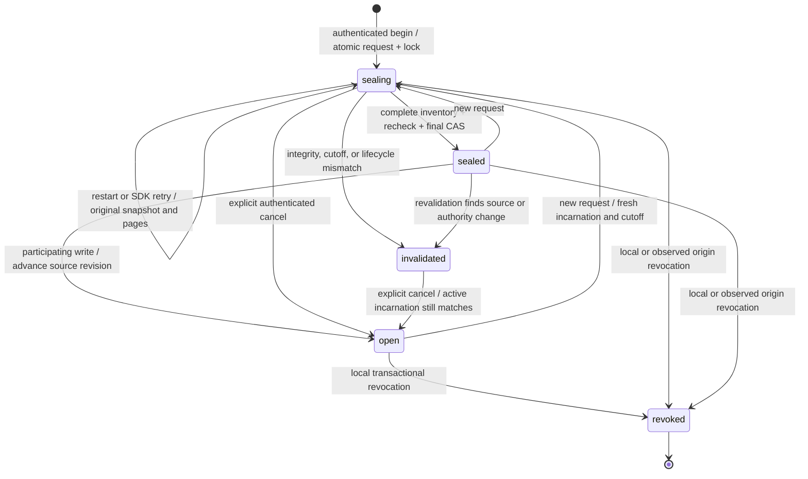

# Stage 4D: isolated admission and inventory sealing

This stage coordinates **local consistency**, never independent authority.
Every decision is `admission: "NOT VERIFIED"`, `admitted: false`,
`publicationEligible: false`. There is no HTTP endpoint, protected Training
acceptance branch, production import, migration, or publisher activation.

## Contracts and persistence

Protocol: `coordinated-inventory-stage4d-v1`. The server derives UID from the
registered Emulator Firebase Auth transport. A protected, active Stage 4C
writer result supplies the root incarnation, original creation metadata,
lifecycle epoch, writer protocol and fence. No request supplies an owner,
Firestore client, inventory, trusted attestation, or authority provider.

Server-only development paths:

| Path | Meaning |
| --- | --- |
| `trainingInventorySeals/{uid}` | Bounded current coordination/revocation state |
| `.../requests/{requestHash}` | Stable request-to-attempt mapping; conflicting cutoff retries reject |
| `.../attempts/{sealId}` | Original handle, snapshot readTime, state and write-once final manifest |
| `.../attempts/{sealId}/pages/{paddedIndex}` | Immutable bounded Stage 4B1 pages |

These paths are outside the user evidence tree so writing a page cannot change
its own inventory digest. They remain denied by the existing demo rules;
no published or local rules were changed. Emulator tests verify client denial.
This does not establish what rules or IAM are deployed in production.

The handle binds exact UID, request ID, root binding and creation timestamp,
lifecycle epoch/revision/head/fence, genesis digest when known, actual journal
cutoff, local source revision and revocation fence, and participant-set digest.
An absent journal is explicitly null, distinguished from a known empty journal.
A missing genesis remains null. Coordination/journal revisions are never used
as session completion chronology, exposure order, or performance evidence.

## State machine

`sealed` means **COORDINATED_SNAPSHOT_SEALED**, not trusted, admitted, published,
or indefinitely current. `check()` reruns source verification; it never treats
a stored phase or matching hash as current authorization. Deletion always
remains possible: it does not need capacity in this ledger. Fresh guard reads
reject a deleting/deleted incarnation. Authenticated observation closes its old
attempt without deleting sources, pages, requests or manifests. If Auth itself
has already been deleted/revoked, authentication rejects before any write;
the stored historical phase never supplies a usable authorization.

## Transaction and writer coordination

The Stage 4C guard still owns every callback attempt and revokes capabilities
on callback exit. Its new `assertCurrentWriterResult` export proves only that
a particular result came from fresh reads in that live attempt. It cannot grant
protected journal access. Seal participants cannot substitute a guard object,
Firestore client, raw SDK transaction, cached result, or serialized context.
The helper derives its document reference from the actual guarded root snapshot.

Each participant reads the same owner control in its source transaction.
`sealing`, `invalidated` and `revoked` block writes. A permitted write queues
the source-revision advance in the **same** commit as its changes; a write after
`sealed` returns the control to `open`, invalidating that cutoff. Proposals are
bound to the guard's unique attempt facade and cannot survive SDK retries.
All validation/reads precede queued writes. Transaction callbacks have no Auth
RPCs, event hooks, source enumeration or irreversible external side effects.

| Participant | Current integration |
| --- | --- |
| V2 acceptance and receipt recovery | Read coordination before existing protected-admission denial; proposed source-version update is queued only with a new acceptance, never a receipt-only retry |
| Stage 4A diagnostic probes | Actual permitted protected diagnostic writer; immutable probe, lifecycle event and coordination update commit together; duplicate probes do not advance the source revision |
| Shadow worker | Claims, heartbeats, artifacts, ready/reschedule and failure-handler writes coordinate; protected performance access remains denied |
| Publication verifier/CAS | Reads coordination and fresh guard state; successful publication remains absent and every write hook rejects |

Creating/running the sealer requires `TRAINING_SEAL_STAGE4D=emulator-only`.
Once enrolled, an account's persisted control is enforced by every participating
writer regardless of a missing/stale process flag. Only actual control absence
permits unenrolled compatibility; that absence is read in the source transaction
and therefore conflicts with concurrent enrollment. Unknown/malformed controls,
closed phases and mismatched account contexts reject without a fallback.
The lookup also covers roots currently classified as legacy, preventing a stale
local classification from skipping an existing enrollment record.

The sealer still requires sanitized Node 24, the exact demo project and loopback
services, and explicit Stage 2/4A/4B1/4B2 development opt-ins. No production
configuration or `.env` is modified. The additional enrollment lookup costs one
read per isolated participant check and no writes for an unenrolled account.
Original-receipt recovery is now 9 reads; the measured final mixed acceptance is
18 reads; publication CAS is 14 reads and zero pointer writes. Stage 4A probes
unconditionally use the existing fresh-read guard path before checking enrollment.

## Inventory verification and recovery

1. Begin atomically records a stable request index, handle, original real
   Firestore readTime and writer lock. Concurrent identical begins return one
   attempt; different or changed-cutoff requests cannot replace that attempt.
2. Reuse Stage 4B1's bounded, revision-pinned enumeration of **all user and
   lifecycle descendants**, including missing parents. Pages retain their
   existing canonical hashes and strict dense-array/descriptor/Unicode checks.
3. Verify actual Stage 4A lifecycle/probe hash-chain records. Reject unknown,
   malformed, conflicting or missing sources and unresolved historical aliases.
   This stage does not admit existing performance/assessment/identity/archive
   histories or root legacy profiles: no such protected Training writer is
   admitted yet. Refusing them preserves those records without inventing origin
   or migration decisions.
4. Write each bounded page immutably in its own guarded transaction. Existing
   equal pages support restart recovery; mismatches fail. A known intentional
   missing Stage 4A probe-container document is retained as absent in the page
   and reviewed only after verifying the real probe ledger. Other missing
   parents remain blocking; no generic orphan exception is added.
5. Enumerate again at a fresh server snapshot. Compare exact records, typed
   source fingerprints and creation/update metadata, and recheck the real
   lifecycle ledger. A source change, new journal cutoff, or owner/fence change
   invalidates the attempt.
6. Read every stored page, verify the whole manifest and record/page sequence,
   then use a bounded final metadata query and CAS to check exact page identities
   and update versions, current incarnation, source revision and revocation
   fence. Store the manifest once; concurrent equal finalizations are idempotent.

Active control and attempt phases must agree. An in-progress attempt must have
a null manifest; a sealed attempt must have a strictly parsed, bounded manifest
with its original schema/hash, owner/lifecycle/journal scope and exact persisted
inventory pin (including original readTime). Corrupt metadata rejects both begin
retries and checks; checks invalidate the control without overwriting the bad
manifest or any source evidence. Full page verification remains mandatory.
Healthy existing records need no schema migration and keep their original hashes.

Limits remain explicit: B1 pages have at most 20 records and 128 KiB serialized
UTF-8; each traversal is bounded at 10,000 records, depth 12 and 30,000 listing
calls. The enforcement counter is local to that traversal, including its concurrent
branches. Public cumulative telemetry does not spend any later traversal's budget.
Concurrent scans and repeated `run`/`check` calls have independent resource limits.
At most 500 inventory pages enter the final projected-name query. Documents
also pass existing Firestore document-size checks. No transaction writes a whole
history; page writes are one document and begin/finalization write bounded
controls only. A prototype account permits 100 sealing attempts, counted
separately from source revisions. Hitting capacity refuses a new attempt before
writes and never deletes source evidence. These are development limits, not a
production scalability claim.

Interruption/lost responses preserve the original handle, request and pages.
Another process can call begin with that same request and run again. An expired
Firestore historical-read window or integrity failure is not replaced with a
different snapshot under the same identity: the owner must cancel and begin a
new request. Cancel never deletes evidence or already written inventory pages.
Mutable drafts, quotas and other preserved user documents are not frozen by
this protocol; their concurrent changes can conservatively invalidate a scan.

## Authority guarantees and deliberately remaining gaps

The admission decision separately reports lifecycle, snapshot, coordination,
origin observation and revocation uncertainty. Independent origin provenance,
production IAM, privileged-writer exclusion and atomic external revocation are
always blockers. It accepts no trusted-origin boolean or signing capability.

Local revocation is transactional with the owner control. Stage 4B2's separate
demo-project revocation is observed before inventory and again before final CAS;
an observed revocation closes the seal. This is **not atomic across projects**.
Auth verification is also not atomic with a later Firestore commit.

An unrestricted Admin can bypass coordination, alter controls, inject a phantom
after the last scan, or roll back data. Two scans and page-version checks do not
remove that gap. The response explicitly has `privilegedMutationGap: true` and
`inventoryAuthority: "NOT VERIFIED"`. An Emulator regression injects a final-gap
phantom: admission/publication remain false, and revalidation rejects it. No
matching hashes, timestamps, root marker or Emulator rule grants authority.

Before protected Training can be enabled, a separately approved stage must
establish independent origin/IAM and revocation, inventory provenance, the full
closed-world native-source/legacy-reconciliation protocol, and enforcement over
every legacy, privileged, deletion and recovery writer. Client rules alone do
not constrain Admin. Only then may protected acceptance and publication be
designed and independently reviewed. Neither is enabled here.

## Original Stage 4D files

New modules: `backend/scalability/sealing.ts`, `sealingContracts.ts`,
`sealingCoordination.ts`, `sealing.test.js`, `sealing.emulator.mjs`.
New tooling: `scripts/build-stage4d.mjs`, `run-stage4d-emulator-tests.mjs`.
New documentation: this file.
Modified isolated modules: `writerGuard.ts`, `acceptance.ts`, `authority.ts`,
`shadowWorker.ts`, `publication.ts`. Existing evidence, receipts, quota,
scoring, adaptive difficulty, frontend and published rules are unchanged.

Run tests with the existing `scripts/run-sanitized.mjs` and pinned Node 24;
the Stage 4D runner requires live loopback demo Auth/Firestore and cannot fall
back to production. Use `scripts/build-stage4d.mjs` for its separate bundle.
Final test/build counts are reported with the implementation handoff; no
100/500/1,000-session throughput or production-readiness claim is made.

Initial implementation validation, before the independent audit and repairs:

| Checks | Result |
| --- | --- |
| New Stage 4D unit cases | 27 passed |
| New Stage 4D Emulator cases | 30 passed (29-case suite plus the added valid-historical-record case) |
| Existing offline scalability/completion/Training cases | 532 passed |
| Existing guard / acceptance / worker / publication / lifecycle Emulator cases | 22 / 53 / 53 / 43 / 50 passed |
| Backend typecheck and active backend build | Passed |
| Separate Stage 2 / 3A / 3B / 4A / 4B1 / 4B2 / 4C / 4D builds | Passed |
| Active backend scalability imports | Zero |
| Whitespace in these 13 implementation files | Clean |

The 30 Emulator cases exercise concurrent begins/finalization, real cooperating
probe/inventory races, protected V2 refusal with quota preservation, deletion,
revocation in both demo realms, missing/duplicate/altered pages, stale journal
cutoffs, valid but unadmitted historical assessments, malformed/unknown/orphan
history, Admin writes between scans and in the final privileged gap, SDK ABORTED
retries, interruption/lost responses, stale proposals, switched accounts,
Unicode UIDs, and existing-rule client denial. No production writes or paid
requests occur. The final added case is executed separately after the full
29-case run. No failures occurred in the executed suites.

The full application suite, frontend checks and expensive large-history Emulator
benchmarks were not rerun for this isolated backend stage. Two existing tracked
whitespace issues in unrelated UI files remain unchanged; the whole-tree diff
check reports those existing lines.

## Security repair scope and reproductions

| Finding | Before repair | Repaired behavior |
| --- | --- | --- |
| Omitted writer flag | A Stage 4A probe committed during `sealing` without advancing the source revision | Persisted enrollment is always read; the same operation rejects with no probe/event/control/quota writes. Permitted writes after sealing advance the source revision even with no flag or a stale value |
| Cumulative listing budget | Injected earlier telemetry of 29,990 allowed a run to reach 29,998, then unchanged check failed at 30,001 and invalidated the control | Real run and check succeed at cumulative totals 29,998 and 30,006; the manifest and sealed control remain unchanged. A separate offline transport test exhausts the real 30,000-call traversal limit and rejects before a further RPC |
| Missing/contradictory sealed metadata | Check returned `COORDINATED_SNAPSHOT_SEALED` with a null stored manifest or contradictory control/attempt phases | Missing/malformed/rehash-mismatched manifests and either phase contradiction reject; source records and corrupt metadata remain untouched for review. Interrupted in-progress and concurrent finalization paths remain supported |

Repair files (11): `authority.ts`, `sealingCoordination.ts`,
`bootstrapInventory.ts`, `sealing.ts`, `sealingContracts.ts`,
`bootstrapInventory.test.js` (new), `sealing.test.js`, `sealing.emulator.mjs`,
`acceptance.emulator.mjs`, `publication.emulator.mjs` under
`backend/scalability/`, and this document. The two existing measurement assertions
are updated for the mandatory enrollment read, without extra quota charges or
evidence writes. Stage 4C capability behavior, immutable source/receipt formats,
manual details, scoring and active production execution paths are unchanged.

New regressions cover missing/stale flags, genuine unenrolled accounts,
unenrolled V2 receipt recovery, incompatible persisted controls, V2/worker/error
handler/publication gates without a flag, concurrent enrollment, cumulative and
concurrent traversal telemetry, real traversal-budget exhaustion without network,
and missing/malformed/hash/binding/phase-corrupt sealed metadata. No production
authority, IAM or rules guarantee is inferred from these Emulator tests.

Repair validation on sanitized Node 24 and loopback demo services:

| Checks | Result |
| --- | --- |
| Stage 4D/manifest and traversal unit tests | 36 passed (9 additional cases) |
| All selected offline scalability/completion/Training tests | 568 passed |
| Full Stage 4D Emulator suite | 44 passed (14 additional cases) |
| Expanded unenrolled receipt/downgraded-root enrollment regression | Passed in a targeted rerun |
| Guard / acceptance / worker / publication / lifecycle Emulator suites | 22 / 53 / 53 / 43 / 50 passed |
| Backend typecheck and active backend build | Passed |
| All separate Stage 2 through 4D builds | Passed |
| Active backend scalability imports | Zero |
| Whitespace in these 11 repair files | Clean |

No new failures occurred. Expected simulated offline, lost-response and storage
failure messages belong to passing recovery tests. The full application suite,
frontend checks and expensive large-history Emulator benchmarks were not rerun.
The same two existing unrelated UI whitespace issues remain in the whole-tree
diff check. No production activation, schema migration, source/receipt rewrite,
quota change, IAM change or published-rule update is required or performed.
